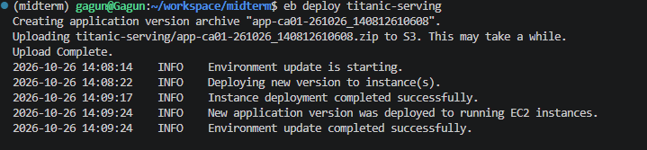
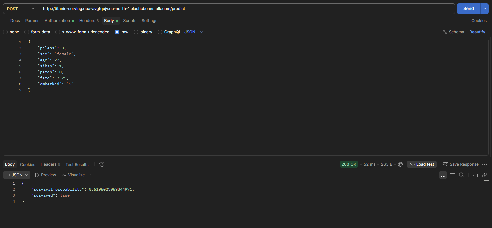

# Titanic survival prediction

## Problem description

This project predicts whether a passenger survived the Titanic disaster using
passenger class, sex, age, fare, embarkation port, and family size. It is a binary
classification task: `survived = 1` means the passenger survived, and `0` means
they did not.

The project uses the public, 891-passenger Titanic dataset hosted by
[Data Science Dojo](https://github.com/datasciencedojo/datasets/blob/master/titanic.csv).
The training script and notebook download the CSV automatically. Family size is
calculated from the numbers of siblings/spouses and parents/children aboard;
missing ages are filled using the training split's mean age.

## Project structure

- [notebook.ipynb](notebook.ipynb): data preparation, exploratory analysis,
  train/validation/test splitting, and model selection. It compares decision
  trees, random forests, and XGBoost with hyperparameter tuning and validation
  ROC AUC results. Saved outputs are included.
- [train.py](train.py): preprocessing, final XGBoost training, held-out test
  evaluation, and artifact saving. It prints the test ROC AUC and creates
  `model.bin`, containing the model, vectorizer, and age-imputation mean.
  This generated artifact is ignored by Git; train before building the image.
- [predict.py](predict.py): Flask service exposing `POST /predict` and
  transforming passenger attributes into model features.
- [predict-test.py](predict-test.py): example client for the local service.
- [pyproject.toml](pyproject.toml) and [uv.lock](uv.lock): dependencies and
  locked environment.
- [Dockerfile](Dockerfile): container configuration for serving predictions
  with Gunicorn.

## Prerequisites

Install [uv](https://docs.astral.sh/uv/getting-started/installation/).
To run the service in a container, also install Docker and start its daemon. The project requires Python 3.14 or
newer; uv can provision Python if needed. Initial setup requires internet access
to download dependencies, the dataset, and container images. `uv sync` creates
the project's `.venv`; `uv run` uses that environment without manual activation.

## Run the notebook

After cloning the repository, install the project dependencies from the project
directory before running [notebook.ipynb](notebook.ipynb):

```bash
uv sync --frozen
```

Open the notebook in your notebook editor and select the project's `.venv` as
the Python environment or kernel. Run the cells in order; the notebook downloads
the dataset automatically.

## Run with Docker

Install the locked dependencies and train the model first (training downloads the
public Titanic dataset):

```bash
uv sync --frozen
uv run python train.py
```

Build and run the prediction service, served by Gunicorn on port 9696:

```bash
docker build -t titanic-predict .
docker run --rm -p 9696:9696 titanic-predict
```

Keep the container running. In another terminal, open the project directory and
run the example prediction client:

```bash
uv run python predict-test.py
```

The client sends a passenger's attributes to `http://localhost:9696/predict`,
checks for HTTP errors, and prints the prediction.

Alternatively, send an example request with curl:

```bash
curl --fail-with-body http://localhost:9696/predict \
  -H 'Content-Type: application/json' \
  -d '{"pclass":3,"sex":"female","age":22,"sibsp":1,"parch":0,"fare":7.25,"embarked":"S"}'
```

The response includes `survival_probability` (between 0 and 1) and a boolean
`survived` prediction, which is `true` when the probability is at least 0.5.
The image includes the trained `model.bin`; retrain and rebuild to update it.

### Prediction input

Send a JSON object with the following passenger attributes:

| Field | Value |
| --- | --- |
| `pclass` | Passenger class: integer `1`, `2`, or `3`. |
| `sex` | `"female"` or `"male"`. |
| `age` | Age in years; omitted or `null` values use the saved training mean. |
| `sibsp` | Number of siblings and spouses aboard. |
| `parch` | Number of parents and children aboard. |
| `fare` | Passenger fare, as a number. |
| `embarked` | Embarkation port: `"C"` (Cherbourg), `"Q"` (Queenstown), or `"S"` (Southampton). Omitted, `null`, or empty values use `"Unknown"`. |

All fields except `age` and `embarked` are required. The service calculates
family size as `sibsp + parch + 1`.

### Alternative: run locally with the EB CLI

You can use the EB CLI to build and run the same Docker service locally on Linux
or macOS. Configure the `eb-cli` AWS credentials profile as described in the
optional AWS section below, then initialize the project and start the service:

```bash
uv sync --frozen
uv run python train.py
uv run eb init -p docker -r eu-north-1 titanic-serving --profile eb-cli
uv run eb local run --port 9696
```

Keep Docker running and stop any other container using port 9696 first. In a
second terminal, run `uv run python predict-test.py`, or send the curl request
above to `http://localhost:9696/predict`. You can also send that request from
Postman using **POST** and **Body → raw → JSON**. Press Ctrl+C in the terminal
running `eb local run` to stop the service.

This command runs the container on your computer and does not create a cloud
environment. AWS requires an initialized EB project for
[`eb local`](https://docs.aws.amazon.com/elasticbeanstalk/latest/dg/eb3-local.html);
the direct Docker commands above run the service without AWS setup.

## Optional: deploy to AWS Elastic Beanstalk

The service has been deployed and tested on AWS Elastic Beanstalk. To deploy
your own instance, run these commands from the project directory.
You need an AWS account with permission to create Elastic Beanstalk resources and the
[AWS CLI](https://docs.aws.amazon.com/cli/latest/userguide/getting-started-install.html)
installed. The EB CLI is included as a development dependency in the lockfile;
`uv sync --frozen` installs it. Use `uv run eb` to run it without activating the
virtual environment.

Configure an AWS credentials profile and verify access:

```bash
aws configure --profile eb-cli
aws sts get-caller-identity --profile eb-cli
```

Enter your IAM access key ID, secret access key, default region `eu-north-1`, and
output format `json` when prompted. If your account uses IAM Identity Center
(SSO), use `aws configure sso --profile eb-cli` and
`aws sso login --profile eb-cli` instead. Keep credentials outside the repository.

Generate the model locally, then initialize the Elastic Beanstalk application
with the Docker platform in Stockholm (`eu-north-1`):

```bash
uv sync --frozen
uv run python train.py
uv run eb init -p docker -r eu-north-1 titanic-serving --profile eb-cli
```

The Dockerfile copies `model.bin` into the image. The model remains ignored by
Git, while [.ebignore](.ebignore) includes it in the deployment bundle along with
the Docker build inputs. This also means deployment uses the current local
files, including uncommitted changes. See the
[AWS EB CLI configuration guide](https://docs.aws.amazon.com/elasticbeanstalk/latest/dg/eb-cli3-configuration.html).

For the first deployment, create an environment (choose a different environment
name if needed):

```bash
uv run eb create titanic-serving
uv run eb status titanic-serving
```

`eb create` provisions the AWS resources and deploys the application. For later
updates, use `eb deploy` against the existing environment; regenerate the model
first if you changed training:

```bash
uv run python train.py
uv run eb deploy titanic-serving
```

### Test the deployed service

Copy the environment's CNAME from `uv run eb status titanic-serving` and replace
`YOUR_ENVIRONMENT_CNAME` below. Send requests to `/predict` using the public HTTP
endpoint; port 9696 is used inside the container.

```bash
curl --fail-with-body http://YOUR_ENVIRONMENT_CNAME/predict \
  -H 'Content-Type: application/json' \
  -d '{"pclass":3,"sex":"female","age":22,"sibsp":1,"parch":0,"fare":7.25,"embarked":"S"}'
```

In Postman, select **POST**, enter the same URL, and choose **Body → raw → JSON**.
Use the passenger JSON from the curl example. A successful response has status
`200 OK` and contains `survival_probability` and `survived`. The application only
defines `POST /predict`, so opening `/` in a browser returns 404.

The screenshots below show the successful AWS deployment and a Postman request
to the deployed endpoint returning `200 OK` with a prediction:





If deployment fails, retrieve the full logs with
`uv run eb logs titanic-serving --all` and inspect `eb-engine.log` for the failed
Docker build step. When you no longer need the environment, remove its running
resources with `uv run eb terminate titanic-serving` to avoid ongoing charges.
